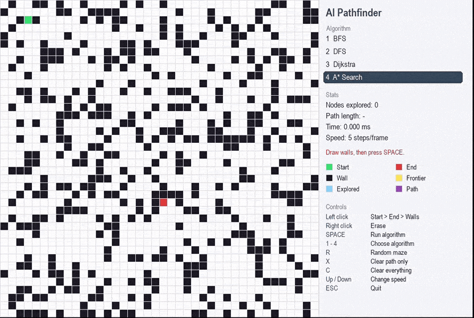

# 🧭 AI Pathfinding & Maze Visualizer



An interactive desktop app built with **Python** and **Pygame** that lets you *watch* classic AI search algorithms find their way through a maze — step by step.

Draw your own maze (or generate a random one), pick an algorithm, and see how it explores the grid, which nodes it visits, and how long the final path is.

---

## ✨ Features

- 🖱️ **Interactive grid** — place Start, End, and wall cells with the mouse; right-click to erase
- 🤖 **Four AI search algorithms** — BFS, DFS, Dijkstra, and A*
- 🎞️ **Smooth step-by-step animation** — see explored nodes, the frontier, and the final path
- 📊 **Live stats** — nodes explored, path length, and execution time
- 🎲 **Random maze generator**
- ⚡ **Adjustable animation speed**
- ⌨️ **Keyboard shortcuts** for everything

---

## 🧠 Algorithms Explained

| Algorithm | Data Structure | Shortest Path? | Idea |
|-----------|----------------|----------------|------|
| **BFS** (Breadth-First Search) | Queue (FIFO) | ✅ Yes | Explores all cells at distance 1, then 2, then 3… like ripples in water |
| **DFS** (Depth-First Search) | Stack (LIFO) | ❌ No | Goes as deep as possible down one path, then backtracks |
| **Dijkstra** | Priority Queue | ✅ Yes | Always expands the cell with the smallest distance from the Start |
| **A\*** (A-Star) | Priority Queue + heuristic | ✅ Yes | Like Dijkstra, but guided toward the goal, so it explores fewer cells |

### A* formula

```
f(n) = g(n) + h(n)
```

- `g(n)` = real cost from Start to cell `n`
- `h(n)` = estimated cost from `n` to End (Manhattan distance)
- Manhattan distance = `|row1 - row2| + |col1 - col2|`

> 💡 In this grid every step costs 1, so BFS, Dijkstra and A* all find a path of the **same length**. The difference you'll see is how many nodes each one explores — A* usually explores the fewest.

### Color legend

| Color | Meaning |
|-------|---------|
| 🟢 Green | Start |
| 🔴 Red | End |
| ⬛ Dark | Wall |
| 🟡 Yellow | Frontier (waiting to be explored) |
| 🔵 Light blue | Explored |
| 🟣 Purple | Final path |

---

## 🛠️ Installation

**Requirements:** Python 3.8 or newer.

```bash
# 1. Clone the repository (or download the ZIP from GitHub)
git clone https://github.com/<your-username>/ai-pathfinding-visualizer.git
cd ai-pathfinding-visualizer

# 2. (Optional) create a virtual environment
python -m venv venv
venv\Scripts\activate        # Windows
# source venv/bin/activate   # macOS / Linux

# 3. Install dependencies
pip install -r requirements.txt

# 4. Run the app
python main.py
```

---

## 🎮 Controls

| Input | Action |
|-------|--------|
| **Left click** | 1st click = Start, 2nd click = End, then draws walls (hold and drag) |
| **Right click** | Erase a cell (hold and drag) |
| **SPACE** / **Enter** | Run the selected algorithm |
| **1** | Select BFS |
| **2** | Select DFS |
| **3** | Select Dijkstra |
| **4** | Select A* |
| **R** | Generate a random maze |
| **X** | Clear only the search result (keep walls) |
| **C** | Clear everything |
| **Up / Down** | Increase / decrease animation speed |
| **ESC** | Quit |

---

## 📁 Project Structure

```
ai-pathfinding-visualizer/
├── main.py            # The whole app: algorithms + visualizer
├── requirements.txt   # Python dependencies
├── README.md          # You are here
└── LINKEDIN_GUIDE.txt # Tips and copy-paste text for LinkedIn
```

---

## 🧩 How the code works (short version)

- Each algorithm is a Python **generator**. It does one step, then `yield`s, so the screen can redraw between steps — that's what creates the animation.
- The grid is a simple 2D list of numbers (empty, wall, start, end, frontier, explored, path).
- The `Visualizer` class handles the window, mouse/keyboard input, and drawing.

---

## 🚀 Ideas for Future Improvements

- Add weighted cells (e.g., "mud" that costs more) to show Dijkstra's real advantage over BFS
- Add Greedy Best-First Search and Bidirectional BFS
- Recursive-division maze generation
- Diagonal movement
- Buttons for mouse-only control

---

## 👩‍💻 Author

**Emaan Bibi** — BS Artificial Intelligence, COMSATS University Islamabad, Attock Campus

- GitHub: `https://github.com/<your-username>`
- LinkedIn: `https://www.linkedin.com/in/<your-profile>`

## 📄 License

This project is open source under the [MIT License](https://opensource.org/licenses/MIT).
